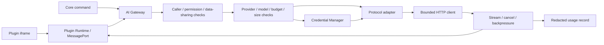

# AI Gateway 设计（Phase 0）

本文件补充 SPEC 第 6 节的实现边界。当前仅运行本机 HTTP fixture；不代表任何真实厂商的 Provider 已交付。

## 模块与数据流

调用者由 Go 的会话上下文产生，拒绝插件在请求中指定 caller、credential 或自授权字段。模型由数据库中的 Provider 与 model key 联合定位，不能仅通过自由文本名称选择。Provider Adapter 处理外部协议，不负责决定用户权限。

## 调用顺序

1. 校验调用者、声明能力、实际授权和允许发送的数据种类。
2. 校验 Provider 状态、模型能力与插件允许使用的 Provider/模型集合。
3. 限制输入字节数、输出上限、超时和并发；取得当前请求的取消 context。
4. 按 credential reference 在 Go 内取得凭据；构造请求时加入认证头，不返回给前端。
5. Adapter 分别处理兼容服务、官方服务与本地服务。接口模式由用户显式选择，连接测试不能只测通域名。
6. 将 chunk 转换为统一事件，记录序号、请求 ID 和终止原因。
7. 仅记录状态、耗时、Provider/模型、调用者和已提供的用量；无真实 token 数据时标记估计或未知。

## 流式协议与取消

Plugin API 的 `AbortSignal` 与回调函数不能直接跨进程序列化。SDK 在本地持有回调，用 `request`、`stream.start`、`stream.chunk`、`stream.end`、`cancel` 消息和请求 ID 关联 Go 请求。所有流有唯一终态，取消、禁用插件、撤销权限或关闭会话后释放 Port 请求和 HTTP body。

建立有界缓冲与 chunk 序号；消费者跟不上时按策略中止并返回可理解的错误，不无界堆积内容。已经向用户输出 chunk 后不自动重试整个请求，避免重复内容与重复计费。

## Endpoint 与隐私边界

- 用户自定义 Endpoint 允许明确配置的 HTTPS 服务；本地 HTTP 只在用户选择的本地模型范围启用。
- 插件不能提交任意 Endpoint、headers 或持有系统配置密钥的 fetch 请求。
- 重定向后若更换 origin，不转发认证头。错误响应和日志必须脱敏。
- 不自动附加数据库、全部笔记或提交代码；发送范围由用户选择并展示。
- 返回内容按不可信数据处理，不自动执行模型生成的命令或工具调用。

## Phase 3 验收

真实 Provider 必须按所选协议完成最小普通/流式调用，并测试 401、429、超时、网络错误、流中断和取消。Provider 列模型能力可以是可选能力，不能假设兼容服务一定支持某个模型列表端点。首次实现先完成一个真实 OpenAI-compatible Provider，再逐个增加官方与本地适配器。
