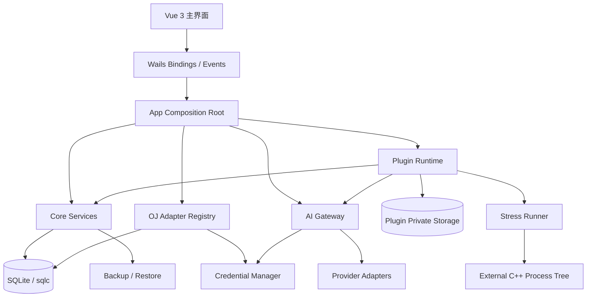
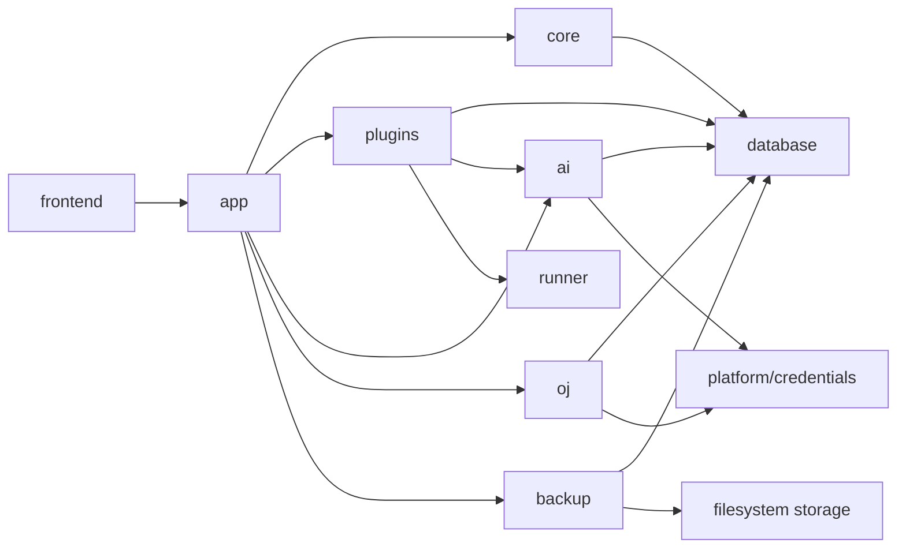

# 系统架构设计

## 1. 设计决策

OI-Desk 采用单进程 Wails 桌面壳、Go 核心服务、Vue 3 前端和受控 Web 插件运行时。所有跨层调用都经过接口；前端和插件不能直接操作 SQLite，插件不能直接拿到 Go 对象、凭据或其他插件目录。

### 最终技术选型

| 层 | 选型 |
|---|---|
| Desktop shell | Wails **v2.10.2**，只使用 v2 API |
| Backend | Go **1.26.2** 基线，`slog`、`context`、标准库 HTTP |
| Database | SQLite 3.x + `database/sql` + `sqlc` + `modernc.org/sqlite` |
| Frontend | Vue **3.5.x** + TypeScript **5.9.x** + Vite **6.x** |
| State/style | Pinia 3.x、Tailwind CSS 4.x、Lucide |
| Charts/editor | ECharts 5.x、Monaco Editor、math.js、Plotly.js |
| Package manager | Node **22 LTS** + pnpm 11 |
| Credentials | Windows Credential Manager / macOS Keychain / Linux Secret Service |
| Plugin UI | Sandboxed iframe + MessageChannel/MessagePort + backend authorization |

精确的前端补丁版本和 Wails 下载/构建结果受本次网络限制影响，必须按 `TECHNICAL_VALIDATION.md` 在 Phase 0 复核后写入锁文件。表中的主版本和职责边界在后续实现中保持稳定。

推荐的职责边界：



### 组件职责

| 组件 | 责任 | 禁止事项 |
|---|---|---|
| Frontend | 展示状态、表单、导航和工作区 | 直接访问数据库或密钥 |
| Core | 数据、设置、搜索、备份、通知和业务规则 | 依赖具体官方插件 |
| OJ adapters | 认证、分页、归一化和原始数据保留 | 直接操作 UI |
| Plugin Runtime | manifest、安装、iframe、会话、权限和存储 | 把权限判断只放在前端 |
| AI Gateway | 调用者鉴权、数据最小化、路由、流式、用量和错误归一化 | 把密钥返回前端 |
| Stress Runner | 工作目录、编译、进程树、限制和输出比较 | 在 Go 主进程中执行用户 C++ |

## 2. 最终项目目录

```text
OI-Desk/
├── SPEC.md
├── docs/
├── backend/
│   ├── app/                 # Wails composition root and bindings
│   ├── core/                # domain services and DTOs
│   ├── database/            # sqlc queries, connection and migrations
│   ├── migrations/
│   ├── oj/                  # platform interface and adapters
│   ├── plugins/             # registry, runtime, permissions, storage
│   ├── ai/                  # gateway and provider adapters
│   ├── contests/
│   ├── backup/
│   ├── notifications/
│   ├── platform/            # OS-specific keychain/process/WebView helpers
│   └── tests/
├── frontend/
│   ├── src/
│   │   ├── components/ views/ stores/ services/
│   │   ├── plugins/ ai/ router/ styles/
│   │   └── generated/        # generated Wails and sqlc-facing types
│   └── tests/
├── plugins/
│   ├── official/{notepad,calculator,snippets,countdown,stress-tester,plotter}/
│   └── examples/hello-world/
├── runner/
│   ├── cpp/
│   └── tests/
├── scripts/
└── build/
```

插件安装目录和用户数据目录由 OS 的应用数据目录 API 决定，不使用当前工作目录。插件包先进入临时目录，验签/校验和路径检查完成后再原子替换。

## 3. 核心模块依赖



依赖方向是单向的：`app` 组装实现，领域包只依赖接口；`oj` 和 `ai` 通过凭据接口访问密钥；`plugins` 只能调用 Core 暴露的受控服务。禁止循环依赖和把 `*sql.DB` 传进插件。

## 4. Wails 与前端边界

Wails v2 只绑定少量稳定的应用命令，例如应用设置、插件管理、同步任务控制、AI Gateway 请求和备份。长任务返回任务 ID，并通过 Wails 事件发送进度；不把数据库模型直接暴露给前端。前端只接收版本化 DTO 和错误码。

Wails 版本冻结后，所有绑定代码只能引用该主版本的 API；构建脚本、运行时事件、asset server 和窗口配置必须对照 v2.10.x 官方文档核验。

## 5. 备份与恢复边界

备份是一个带 manifest、schema version、文件列表、SHA-256 和创建时间的归档。核心数据库使用 SQLite 在线备份 API 或短事务快照；插件数据和用户设置以文件条目加入归档；Provider 配置只导出 credential reference，不导出密钥。恢复先解压到隔离临时目录、校验清单和版本，再原子替换，失败时保留原数据。

