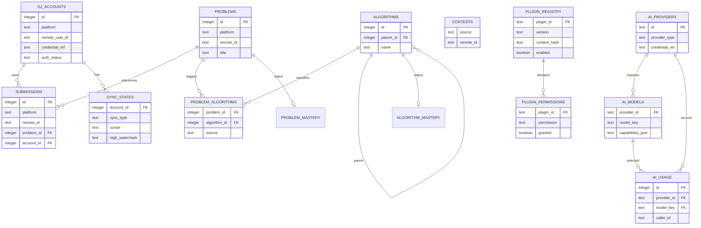

# 数据库设计审查与目标模型

## 1. 现有 SPEC 模型的问题

`SPEC.md` 给出的表可以覆盖最小数据范围，但直接实现会有以下缺陷：

1. `oj_accounts` 没有账号去重约束，重复添加同一平台同一用户会产生多个账户。
2. `submissions.problem_id` 和 `problem_algorithms.problem_id` 没有保证与 `platform` 一致，跨平台错误关联在 SQLite 中仍可写入。
3. `sync_states` 缺少 `(account_id, sync_type)` 唯一约束，恢复同步时可能出现多个游标。
4. `contests` 缺少 `(source, remote_id)` 唯一约束，远程比赛会重复。
5. `problem_algorithms` 没有掌握状态表；题目和算法的学习状态要求无法落库。
6. `plugin_permissions`、`ai_models` 和 `ai_usage` 没有完整外键和删除策略，插件/Provider 删除后会留下悬空记录。
7. `ai_usage.model_id` 是自由文本，无法区分同名模型或关联已删除模型。
8. `app_settings` 没有 key/value、类型、版本和更新时间约定。
9. `oj_accounts` 没有 credential reference，容易让后续实现把 Cookie 误放进 SQLite。
10. SQLite 的 `DATETIME` 没有内建时区语义；若不统一格式，UTC 和本地时间会混用。
11. 缺少全文搜索索引，无法高效实现全局搜索。
12. `metadata_json`、manifest 和 Provider config 没有 JSON 校验、大小上限和敏感字段过滤约定。

## 2. 修正原则

- 所有时间使用 RFC3339 UTC 文本或 UTC Unix 毫秒，推荐 RFC3339 UTC 以便审计。
- 每次连接执行 `PRAGMA foreign_keys=ON; PRAGMA journal_mode=WAL; PRAGMA busy_timeout=5000;`。
- 外键删除策略显式写出：账号删除 `RESTRICT` 或软删除；提交引用题目 `SET NULL`；插件权限 `CASCADE`；Provider 模型和用量按审计需要 `RESTRICT`/保留。
- 平台远程键均按文本保存，避免 Codeforces 等平台的数值 ID 溢出或格式差异。
- 写入同步页使用事务和幂等 upsert；游标和水位与账号、同步类型一一对应。
- 插件私有数据放独立文件树或独立 SQLite 文件，核心数据库只保存注册表和权限。
- 真实密钥只保存系统密钥环引用。

## 3. 目标核心实体

实现时保留 SPEC 的业务名称，同时增加必要约束和辅助表：

```text
oj_accounts(platform, remote_user_id, username, credential_ref, auth_status, ...)
problems(platform, remote_id, title, url, difficulty, metadata_json, ...)
submissions(platform, remote_id, problem_id, account_id, submit_time, ...)
algorithms(parent_id, name, description, sort_order, ...)
problem_algorithms(problem_id, algorithm_id, source, confidence, ...)
problem_mastery(problem_id, state, updated_by, updated_at)
algorithm_mastery(algorithm_id, state, updated_by, updated_at)
sync_states(account_id, sync_type, cursor, high_watermark, status, ...)
contests(source, remote_id, name, start_time, end_time, timezone, ...)
plugin_registry(plugin_id, version, install_path, content_hash, enabled, ...)
plugin_permissions(plugin_id, permission, granted, updated_at, ...)
ai_providers(id, provider_type, base_url, api_mode, credential_ref, ...)
ai_models(provider_id, model_key, display_name, capabilities_json, ...)
ai_usage(provider_id, model_key, caller_type, caller_id, status, ...)
app_settings(key, value_json, value_type, updated_at)
```

`platform` 和 `remote_id` 保留为联合唯一键。为防止子表的 platform 错配，有两种实现方式：优先使用 `problems.id`/`algorithms.id` 的外键并在服务层拒绝不一致数据；若需要数据库级强制，则为 `problems` 增加 `(id, platform)` 唯一键并在引用表使用复合外键。

## 4. ER 图



## 5. 索引和并发

必须建立 `(platform, remote_id)`、`(account_id, submit_time)`、`(problem_id, submit_time)`、`(algorithm_id, source)`、`(plugin_id, permission)`、`(provider_id, model_key)` 和同步状态索引。大列表必须分页。同步任务每个账号和类型只允许一个活动执行者，使用应用锁或数据库租约避免重复同步。

## 6. 迁移策略

迁移按单调版本号执行，每个迁移在事务中完成并记录 checksum。启动时先检查 schema version，失败则阻止写入并显示可恢复错误。删除或重建关键表前必须生成自动备份。Phase 0 只验证迁移框架，不创建完整业务表。

