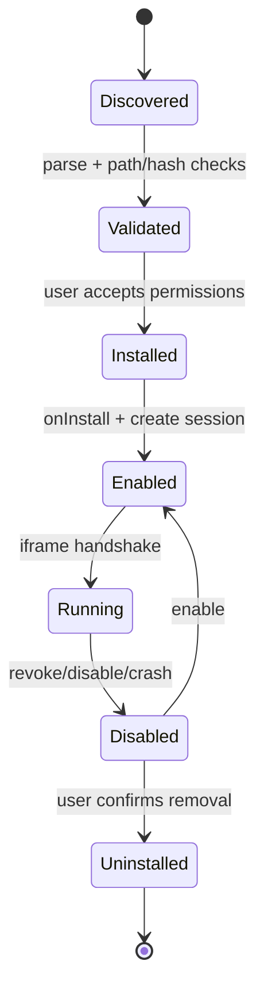
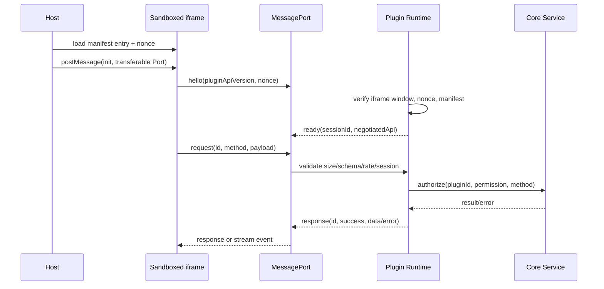

# 插件运行时与通信设计

## 1. 隔离模型

插件是默认不可信的 Web 内容。主界面创建 `<iframe sandbox="allow-scripts">`，不授予 `allow-same-origin`、`allow-top-navigation`、`allow-popups` 或任意本地文件权限。插件资源由核心的受控资源服务提供，来源和路径由已安装 manifest 映射；插件通过 `MessagePort` 获得能力，而不是通过 Wails 绑定。

沙箱不是唯一防线：每个请求仍需由运行时验证会话、插件 ID、方法 schema、权限、大小和速率。插件只能使用自身数据目录，网络请求、文件导入导出和 AI 调用都由核心代理。

## 2. Manifest 约束

安装时检查：插件 ID、语义化版本、入口和资源路径、核心版本范围、权限枚举、AI 能力、压缩包路径穿越、文件大小和内容 hash。未知字段忽略但不执行。安装包先解到临时目录；完成校验并取得用户授权后原子移动。

建议补充字段：`contentHash`、`apiVersion`、`csp`、`networkPolicy` 和 `dataVersion`。manifest 原文只用于展示和审计，运行时使用校验后的结构体。

## 3. 生命周期



`onInstall`、`onEnable`、`onDisable`、`onUninstall` 是协议事件，不允许插件阻塞核心状态转换。每个钩子都有超时、取消和错误记录；钩子失败会使该插件进入 disabled/error 状态，不使主进程退出。禁用和卸载默认保留私有数据，清理数据必须二次确认。

## 4. 握手和请求



消息结构固定为：

```ts
interface PluginRequest {
  id: string;
  type: "request" | "cancel" | "event";
  method: string;
  payload?: unknown;
}

interface PluginResponse {
  id: string;
  success: boolean;
  data?: unknown;
  error?: { code: string; message: string; retryable?: boolean };
}
```

`pluginId` 不从插件请求体读取，由会话上下文注入。方法使用白名单路由表和 JSON Schema 校验，不能把任意字符串当作 Go 方法名。单消息、单请求并发数和总流量都有上限；请求必须有超时，取消请求通过同一 Port 发送可序列化的 cancel 消息。

## 5. API 分组

第一版 API 只开放以下命名空间：

| API | 权限 | 说明 |
|---|---|---|
| `storage.get/set/delete/list` | storage | 仅当前插件 key-space |
| `theme.get` | theme | 返回不可变主题 DTO |
| `clipboard.read/write` | clipboard | 受平台限制并记录审计 |
| `notification.show` | notification | 文本和长度限制 |
| `problem.list/get` | problem.read | 分页、字段白名单 |
| `submission.list/get` | submission.read | 分页，不返回凭据 |
| `algorithm.list` | algorithm.read | 只读分类和标签 |
| `contest.list` | contest.read | 只读比赛信息 |
| `ai.chat/stream` | ai.chat | 进入 AI Gateway |
| `file.import/export` | 对应权限 | 必须由用户发起文件选择 |

`network` 只允许访问核心维护的域名和方法策略；它不提供任意 `fetch`。AI API 永远不暴露 key、credential reference 的真实值或带认证头的原始请求。

## 6. 权限和审计

安装时展示 manifest 声明和数据流向；高风险权限单独确认。用户撤销后运行时立即拒绝新请求，已有请求在安全边界取消。权限决策在 Go 后端重复执行，前端只负责展示。审计记录保存插件、方法、结果类别、耗时和错误码，不保存密钥及默认情况下的完整 Prompt/响应。

